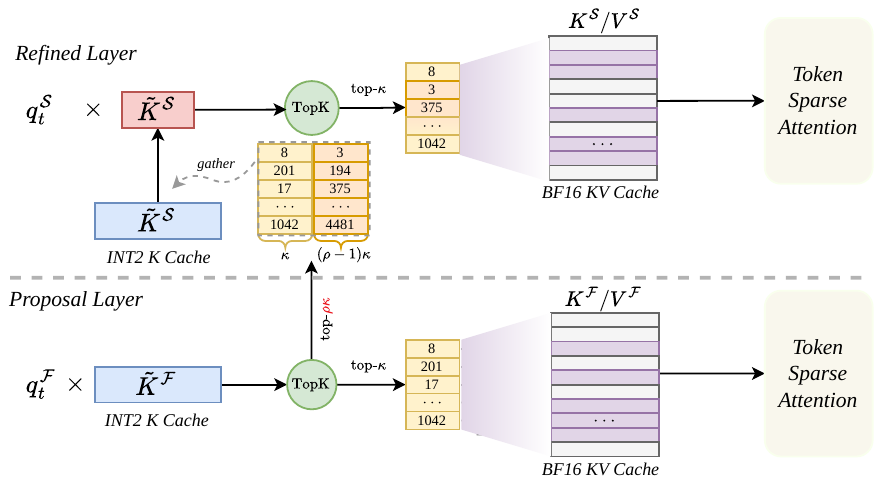
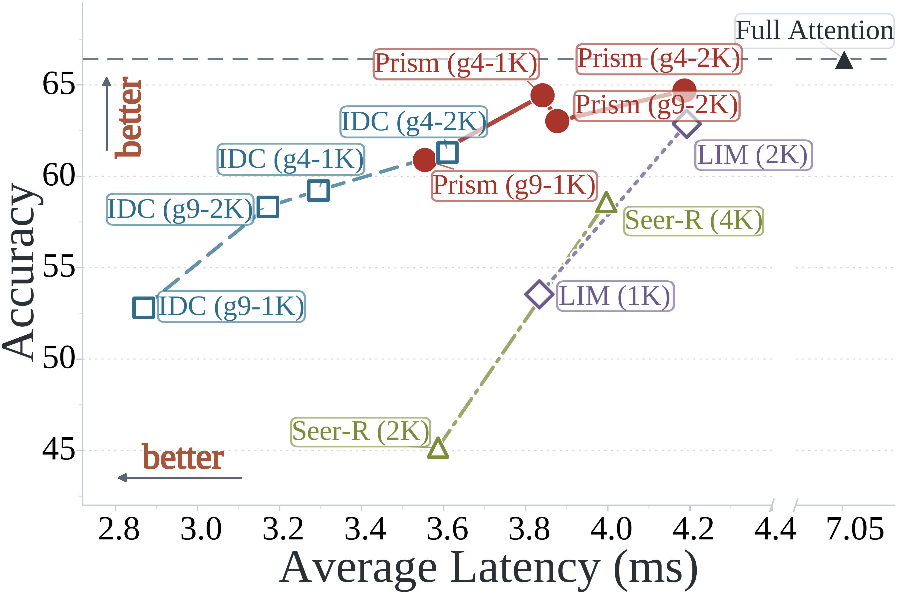

<div align="center">

# 🔮 Prism Attention: Proposal-Refined Index Sharing Mechanism for Efficient LLMs Inference

[](#-news)
[](https://arxiv.org/abs/2610.22985)
[](https://arxiv.org/pdf/2610.22985)
[](LICENSE)

</div>

---

## 🎉 News

- **[2026-09]** Prism Attention has been **accepted to NeurIPS 2026**. 🎉
- **[2026-09]** Code release: Qwen3 decoding model (`prism` / `indexcache` / `dense` modes), INT2 key-cache Triton kernels, offline IndexCache calibration, and the reasoning / LongBench evaluation harnesses.

## 📖 Quick Scan

Token-level sparse attention makes long-context decoding cheaper, but finding the top-$\kappa$ tokens still requires scoring the **entire** KV cache at **every** layer. Cross-layer index sharing avoids that by computing indices only at a few anchor layers and reusing them downstream — at the cost of accuracy, because attention patterns drift with depth and reused indices progressively miss the layer-wise optimum.

**Prism Attention** replaces rigid reuse with a coarse-to-fine scheme. A *Proposal Layer* emits an **expanded** candidate pool of $n = \rho\kappa$ tokens scored against an **INT2-compressed** key cache; each downstream *Refined Layer* re-scores only those $n$ candidates with its own query and picks its own top-$\kappa$. Selection cost per refined layer drops from $\mathcal{O}(L_t)$ to $\mathcal{O}(\rho\kappa)$ — constant in context length — while layer-wise adaptability is preserved.



The design is motivated by a measurable property of attention dynamics: **inter-layer salient token shift is highly localized**. The exact top-$\kappa$ sets differ across layers, but the core high-attention tokens are stable and most changes land near the boundary of the previously selected region. The index overlap between an anchor layer and its downstream layers decays sharply with distance, and faster at longer contexts.

Prism Attention features:
- **Dynamic Index Refinement** — refined layers perform a bounded local top-$\kappa$ search inside the inherited proposal pool instead of inheriting a frozen index set.
- **Quantized Proposal Generation** — proposal scoring runs on a group-wise asymmetric INT2 key cache with a fused dequant + QK$^\top$ + GQA max-reduce Triton kernel, cutting the memory traffic of full-context scanning.
- **Training-free** — only an offline layer-partition calibration is needed; model weights are untouched.
- **Drop-in HF model** — `PrismDecodingQwen3ForCausalLM` loads any Qwen3 checkpoint via `from_pretrained`, with `prism`, `indexcache`, and `dense` modes in one class for apples-to-apples comparison.

## 📂 Repository Structure

```
prism_github_final/
├── prism_attn/                              # installable package (pip install -e .)
│   ├── decode_sparse/
│   │   ├── qwen3/
│   │   │   ├── configuration_qwen3_prismattn.py   # PrismQwen3Config
│   │   │   └── modeling_qwen3_prismattn_inference.py
│   │   │                                    # PrismDecodingQwen3ForCausalLM,
│   │   │                                    # Qwen3PrismAttention, reuse-map resolution
│   │   ├── attn_gate_inf.py                 # C2AttnGate: proposal / top-k selector
│   │   ├── cache_quant_utils.py             # KC2CompressionCacheBuffered (INT2 K cache)
│   │   ├── attention_forward_dense.py       # FlashAttention prefill + left-pad flash decode
│   │   └── attention_forward_sparse.py      # token-sparse decode path
│   ├── kernels/
│   │   ├── quant/int2_quant.py              # int2_quantize: 2-bit group-wise K quantization
│   │   ├── quant/int2_qk_maxreduce.py       # int2_attention_score{,_indexed}: fused
│   │   │                                    # dequant + QK^T + GQA max-reduce (+ sink/recent)
│   │   ├── varlen/flash_decode_varlen_left_pad_max_v2.py  # flash_decode_leftpad
│   │   └── varlen/token_sparse_decode_optimized.py        # token_sparse_flash_decode_optimized
│   ├── modules/                             # fused RMSNorm (Triton) + rotary helpers
│   └── utils.py                             # HF outputs extended with k_compressed_cache
├── calibrate/indexcache/                    # offline Proposal/Refined layer calibration
│   ├── offline_calibration.py
│   ├── run_calibration.sh
│   └── output-g4/indexcache_config.json     # shipped Qwen3-4B g4 partition
├── eval/
│   ├── reasoning_tasks/                     # AIME24/25, MATH500, GPQA, OlympiadBench, LiveCodeBench
│   │   ├── scripts/eval_prism_attention.sh
│   │   ├── parallel_run_hf.py               # multi-GPU launcher
│   │   ├── eval_hf.py                       # single-GPU generation worker
│   │   └── summary_results.py               # Pass@1 aggregation
│   └── longbench/                           # LongBench / LongBench-E
│       ├── eval_longbench_prism.sh
│       ├── pred_threshold_decode.py
│       ├── eval.py  metrics.py  average_score.py
│       └── config/                          # dataset2prompt / dataset2maxlen / model2maxlen
└── assets/                                  # figures used in this README
```

## 💻 System Environment

The environment used to produce the paper numbers:

| Component | Specification | Notes |
| :--- | :--- | :--- |
| **OS** | Ubuntu 22.04 LTS | |
| **Python** | 3.11 | Recommended |
| **PyTorch** | 2.4.0 | `torch>=2.4.0` |
| **Triton** | 3.0.0 | **Required** — all custom kernels are Triton |
| **transformers** | 4.51.0 | Pinned; the model subclasses HF Qwen3 |
| **CUDA** | 12.1+ | **Required** |
| **GPU** | NVIDIA H800 / A100 / H100 (80GB) | Paper latency measured on H800 |

> The INT2 scoring kernel uses an inline PTX `cvt.rn.f16x2.e4m3x2` trick, so an SM80+ (Ampere or newer) GPU is required. Decode kernels assume a GQA group size of at most 16 query heads per KV head.

## ⚙️ Installation

```bash
# 1. Environment
conda create -n prism python=3.11 -y
conda activate prism

# 2. PyTorch
pip install torch==2.4.0

# 3. Dependencies + the package itself
git clone <this-repo> && cd prism_github_final
pip install -r requirements.txt
pip install flash-attn==2.5.8 --no-build-isolation   # prefill + dense decode baseline
pip install -e .
```

## ⚡ Quick Start

Prefill always runs dense (FlashAttention varlen); sparsity applies to the decoding steps.

```python
import torch
from transformers import AutoTokenizer
from prism_attn import PrismDecodingQwen3ForCausalLM

model_name = "Qwen/Qwen3-4B"
tokenizer = AutoTokenizer.from_pretrained(model_name, padding_side="left")

model = PrismDecodingQwen3ForCausalLM.from_pretrained(
    model_name,
    torch_dtype=torch.bfloat16,
    attention_method="prism",       # "prism" | "indexcache" | "dense"
    token_budget=2048,              # final sparse budget kappa
    candidate_factor=2.0,           # proposal expansion rho -> pool of rho * kappa
    proposal_layers=[0, 7, 8, 13, 14, 18, 21, 28, 35],   # from offline calibration
    sink_size=64,
    recent_size=192,
    use_flash_rope=True,            # fused rotary kernel
    fused_norm=True,                # fused Triton RMSNorm
).cuda().eval()

prompt = "Solve: find all integer solutions of x^2 - 3y^2 = 1 with |x| < 50."
inputs = tokenizer([prompt], return_tensors="pt").to("cuda")
out = model.generate(**inputs, max_new_tokens=512, do_sample=False)
print(tokenizer.decode(out[0], skip_special_tokens=True))
```

## 🎛️ Configuration

All knobs live in `PrismQwen3Config` (`prism_attn/decode_sparse/qwen3/configuration_qwen3_prismattn.py`) and can be passed straight to `from_pretrained`.

| Argument | Default | Meaning |
| :--- | :--- | :--- |
| `attention_method` | `"prism"` | `prism` = proposal-refined sharing; `indexcache` = rigid index reuse baseline; `dense` = full attention |
| `token_budget` | `4096` | final sparse budget $\kappa$ per KV head (paper uses `2048`) |
| `candidate_factor` | `2.0` | proposal expansion $\rho$; pool size is $\rho\kappa$. **Must be `1.0` when `attention_method="indexcache"`** |
| `proposal_layers` | `None` | layer indices that build a fresh proposal; every other layer refines from the nearest preceding one |
| `reuse_map` | `None` | explicit `{refined_layer: proposal_layer}` mapping; takes precedence over `proposal_layers` |
| `start_layer` | `0` | layers with `layer_idx < start_layer` stay dense |
| `sink_size` | `64` | leading tokens always kept in the selector |
| `recent_size` | `192` | trailing tokens always kept in the selector |
| `int2_group_size` | `32` | group size along `head_dim` for INT2 K quantization |
| `max_cache_length` | `32768` | preallocated length of the compressed K cache — **raise this for >32K contexts**, tokens beyond it are dropped from the selector |
| `fused_norm` | `False` | use the Triton fused RMSNorm |
| `use_flash_rope` | `False` | use the FlashAttention rotary kernel |

If neither `reuse_map` nor `proposal_layers` is given, every layer computes its own indices (no cross-layer sharing).

### Environment overrides

Useful for sweeping configurations from shell scripts; they take precedence over the config values.

```bash
export PRISM_CANDIDATE_FACTOR=2.0                       # overrides candidate_factor
export PRISM_PROPOSAL_LAYERS=0,7,8,13,14,18,21,28,35    # overrides reuse_map / proposal_layers
```

Reuse-map resolution order: `PRISM_PROPOSAL_LAYERS` → `config.reuse_map` → `config.proposal_layers` → no sharing.

## 🧭 Offline Calibration (Proposal / Refined partition)

Which layers act as proposal layers is decided once, offline, by a greedy/beam search that minimizes token-level cross-entropy on a held-out calibration set — the same training-free procedure IndexCache uses, adapted to Qwen3.

```bash
cd calibrate/indexcache
bash run_calibration.sh
```

Edit the variables at the top of `run_calibration.sh` before running:

| Variable | Script default | Meaning |
| :--- | :--- | :--- |
| `model_dir` | `Qwen/Qwen3-4B` | calibrated checkpoint |
| `data_path` | `../data/openr1_1000.jsonl` | calibration corpus (OpenR1-MATH-220k sample, shipped) |
| `num_samples` | `32` | calibration samples (paper uses 64) |
| `max_seq_len` | `32768` | truncation length |
| `k` | `512` | sparse budget used *during* calibration |
| `retention_ratio` | `1/9` | fraction of layers kept as proposal layers — `0.25` → g4 (1:3), `1/9` → g9 (1:8) |
| `search_mode` | `loss` | search objective |
| `beam_size` | `1` | `1` = greedy, `2`/`4` = beam search |
| `loss_last_frac` | `1.0` | fraction of trailing tokens scored by the loss |

The run writes `${output_dir}/indexcache_config.json` with `f_layers` (proposal layers), `s_layers`, `s_to_f_mapping`, the baseline/calibrated losses and the full search log. A calibrated Qwen3-4B g4 partition is shipped at `calibrate/indexcache/output-g4/indexcache_config.json`:

```json
"f_layers": [0, 7, 8, 13, 14, 18, 21, 28, 35],
"retention_ratio": 0.25, "num_layers": 36, "loss_delta": 0.0092
```

Feed `f_layers` into inference either as `proposal_layers=[...]` or via the environment:

```bash
export PRISM_PROPOSAL_LAYERS=0,7,8,13,14,18,21,28,35
```

Calibration is memory-intensive at long sequence lengths; `offline_calibration.py` supports `torch.distributed` (it reads `RANK` / `LOCAL_RANK`) and falls back to single-GPU when `RANK` is unset.

## ⚖️ Evaluation

### Reasoning benchmarks

AIME24 / AIME25 / MATH500 / GPQA-Diamond / OlympiadBench / LiveCodeBench, with per-task batch size and sample count already set in `parallel_run_hf.py` (`aime24`/`aime25`: 64 runs, `math`: 8, `gpqa`: 16).

```bash
cd eval/reasoning_tasks
bash scripts/eval_prism_attention.sh
```

Knobs at the top of the script:

```bash
model_dir="Qwen/Qwen3-4B"
attention_method="prism"      # prism / indexcache / dense / fa2 / sdpa
tasks="aime24,aime25,math,gpqa"
token_budget="2048"           # comma-separated list to sweep budgets
max_tokens=32768
num_gpus=8
limit=-1                      # -1 = all problems
start_layer=0

export PRISM_CANDIDATE_FACTOR=2.0
export PRISM_PROPOSAL_LAYERS=0,7,8,13,14,18,20,21,28
```


### LongBench

```bash
cd eval/longbench

# 1. Prediction -> ./results/prism/pred_e/{dataset}.jsonl
bash eval_longbench_prism.sh

# 2. Scoring (--model is the directory holding the prediction jsonl files)
python eval.py --model ./results/prism/pred_e --e

# 3. Averages per length bucket (0-4k / 4-8k / 8k+)
python average_score.py ./results/prism/pred_e/result.json
```

`--e` restricts prediction to the nine long-input LongBench-E subsets reported in the paper; drop it for the full 21-subset LongBench. Prompt templates and per-dataset generation lengths live in `config/`.

## 📊 Results

Setup: Qwen3-4B / Qwen3-8B on H800, sparse budget $\kappa = 2048$, g4 partition (1 proposal layer per 4 layers), $\rho = 2$ for reasoning and $\rho = 4$ for long-context. Reasoning numbers are Pass@1 (64 samples for AIME24/25, 8 for MATH500, 16 for GPQA) with 32K max generation.

### Reasoning accuracy

| Model | Method | AIME24 | AIME25 | GPQA | MATH500 | Avg. |
| :--- | :--- | :--- | :--- | :--- | :--- | :--- |
| Qwen3-4B | Full Attention | 71.25 | 66.41 | 56.19 | 93.93 | 71.95 |
| | Quest | 46.67 | 39.79 | 24.74 | 73.40 | 46.15 |
| | Seer-R | 69.32 | 58.59 | 55.40 | 94.10 | 69.35 |
| | LessIsMore | 71.48 | 62.87 | **56.23** | **94.12** | 71.18 |
| | IndexCache | 70.99 | 61.30 | 54.29 | 94.05 | 70.16 |
| | **Prism** | **72.60** | **64.27** | 54.83 | 94.00 | **71.43** |
| Qwen3-8B | Full Attention | 74.48 | 67.86 | 60.54 | 94.43 | 74.33 |
| | Quest | 59.79 | 57.71 | 47.22 | 87.80 | 63.13 |
| | Seer-R | 71.35 | 57.81 | 60.48 | 94.00 | 70.91 |
| | LessIsMore | 73.00 | 65.24 | **60.65** | **94.55** | 73.36 |
| | IndexCache | 74.84 | 64.47 | 60.39 | 94.40 | 73.53 |
| | **Prism** | **75.05** | **65.52** | 60.45 | 94.30 | **73.83** |

### LongBench accuracy (nine long-input subsets)

| Model | Method | 2WikiMQA | TriviaQA | HotpotQA | TREC | Qasper | PCount | MF-en | PRe | GovReport | Avg. |
| :--- | :--- | :--- | :--- | :--- | :--- | :--- | :--- | :--- | :--- | :--- | :--- |
| Qwen3-4B | Full Attention | 62.68 | 89.69 | 69.79 | 45.00 | 29.35 | 22.26 | 49.16 | 99.06 | 28.66 | 55.07 |
| | Seer-R | 59.07 | **90.42** | 69.59 | 48.00 | 19.19 | **24.36** | **50.49** | **100.00** | 28.19 | 54.37 |
| | LessIsMore | **62.57** | 82.62 | **70.73** | 41.00 | 21.43 | 16.67 | 49.83 | 98.00 | 28.42 | 52.36 |
| | IndexCache | 57.73 | 87.28 | 70.64 | 37.00 | **26.92** | 22.12 | 49.16 | **100.00** | 28.54 | 53.27 |
| | **Prism** | 60.36 | 89.76 | 70.16 | **52.00** | 23.89 | 20.35 | 49.75 | **100.00** | **28.57** | **54.98** |
| Qwen3-8B | Full Attention | 64.77 | 89.02 | 70.45 | 31.33 | 31.52 | 24.95 | 50.54 | 100.00 | 28.66 | 54.58 |
| | Seer-R | **66.17** | 89.59 | 68.58 | 34.00 | 27.53 | 21.67 | 46.51 | **100.00** | 28.70 | 53.64 |
| | LessIsMore | 58.78 | 89.32 | 68.63 | 31.00 | 24.74 | 21.17 | 37.25 | **100.00** | 27.93 | 50.98 |
| | IndexCache | 60.50 | **91.49** | **71.46** | 27.00 | **30.58** | 21.19 | 43.45 | 99.12 | **29.07** | 52.65 |
| | **Prism** | 65.19 | 91.19 | 70.61 | **34.03** | 25.67 | **27.11** | **52.12** | **100.00** | 28.81 | **54.97** |

Prism has the best sparse average on both models — 54.98 on Qwen3-4B (within 0.09 of Full Attention, +1.71 over IndexCache) and 54.97 on Qwen3-8B (above Full Attention's 54.58, +2.32 over IndexCache).

### Efficiency

End-to-end per-step decoding latency on Qwen3-4B with SGLang under a 2K sparse budget (ms, speedup over FlashAttention in parentheses):

| Method | 16K, BSZ=1 | 16K, BSZ=16 | 64K, BSZ=1 | 64K, BSZ=16 | 128K, BSZ=1 | 128K, BSZ=16 |
| :--- | :--- | :--- | :--- | :--- | :--- | :--- |
| FlashAttention | 2.151 (1.00×) | 4.057 (1.00×) | 2.623 (1.00×) | 8.748 (1.00×) | 3.074 (1.00×) | 15.025 (1.00×) |
| Seer-R | 2.520 (0.85×) | 3.101 (1.31×) | 2.580 (1.02×) | 3.208 (2.73×) | 2.659 (1.16×) | 3.483 (4.31×) |
| LIM | 2.399 (0.90×) | 3.465 (1.17×) | 2.517 (1.04×) | 4.166 (2.10×) | 2.667 (1.15×) | 5.147 (2.92×) |
| IDC-g4 | 2.261 (0.95×) | 2.854 (1.42×) | 2.317 (1.13×) | 3.550 (2.46×) | 2.450 (1.26×) | 4.434 (3.39×) |
| IDC-g9 | 2.026 (1.06×) | 2.557 (1.59×) | 2.062 (1.27×) | 2.912 (3.00×) | 2.156 (1.43×) | 3.348 (4.49×) |
| **Prism-g4** | 2.492 (0.86×) | 3.302 (1.23×) | 2.565 (1.02×) | 3.835 (2.28×) | 2.678 (1.15×) | 4.467 (3.36×) |
| **Prism-g9** | 2.314 (0.93×) | 3.091 (1.31×) | 2.374 (1.11×) | 3.343 (2.62×) | 2.474 (1.24×) | 3.703 (4.06×) |

The refinement overhead Prism adds over rigid IndexCache reuse shrinks as context grows — 15.7% at 16K, 8.0% at 64K, 0.7% at 128K — because refinement scans only the inherited candidate pool, a cost independent of context length. At the kernel level a refined layer is 12.59× faster than FlashAttention at 128K (a proposal layer 2.07×), giving 7.50× amortized speedup at 128K with BSZ=16.



Prism occupies the high-accuracy end of the Pareto frontier: Prism-g4-1K reaches 64.43 on AIME25 at 3.84 ms/token, 1.84× faster than Full Attention at 97.0% of its accuracy, dominating LIM-2K (62.87 at 4.19 ms) and Seer-R-4K (58.59 at 4.00 ms).

### Recommended hyperparameters

From the ablations: $\rho \in [2, 4]$ and $\kappa \in [1024, 2048]$. Raising $\rho$ from 1 to 4 lifts AIME25 from 59.22 to 64.43, while $\rho = 8$ regresses slightly — an oversized proposal pool dilutes the refinement stage with noisy candidates. Raising $\kappa$ helps monotonically (57.66 at 512 → 65.26 at 4096), with most of the gain already at 1024.


## 📝 Citation

If you find Prism Attention useful in your research, please consider citing:

```bibtex
@article{tian2026prism,
  title={Prism Attention: Proposal-Refined Index Sharing Mechanism for Efficient LLMs Inference},
  author={Zhenxu Tian and Kebin Liu and Zhengwu Yang and Yi Su and Qingqing Dang and Yanlin Sha and Kaipeng Deng and Dianhai Yu and Yanjun Ma and Juntao Li and Min Zhang},
  journal={arXiv preprint arXiv:2610.22985},
  year={2026}
}
```

